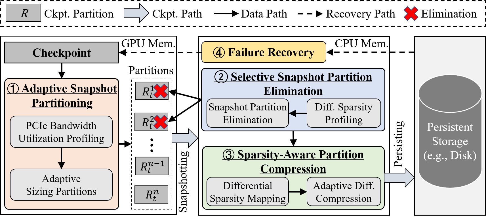

# APCheck: Adaptive Partitioned Checkpointing for Distributed Large Language Model Training

**APCheck** is an adaptive partitioned checkpointing framework designed to reduce checkpointing overhead in distributed large language model (LLM) training. Existing checkpointing systems typically employ static partitioning, using predefined partition sizes throughout each training pass. However, PCIe bandwidth utilization varies substantially at runtime, making static partitioning inefficient. Large partitions can cause bandwidth contention under high PCIe utilization, while small partitions fail to fully utilize available bandwidth under low utilization. To address these limitations, **APCheck dynamically adjusts checkpoint partition sizes according to runtime PCIe bandwidth utilization**, using smaller partitions under high utilization and larger partitions under low utilization to improve checkpointing efficiency and reduce training stalls.

Furthermore, APCheck incorporates two optimization techniques:
- **Selective Partition Snapshot Elimination:** Skips snapshotting for partitions with fully sparse differentials, reducing GPU-to-CPU snapshotting overhead.
- **Sparsity-Aware Partition Compression:** Dynamically adjusts compression ratios according to partition-level differential sparsity, improving compression efficiency and reducing persistence I/O overhead.

Experiments on local and cloud clusters with representative LLMs demonstrate that APCheck reduces training time by up to **32.14%** and checkpointing time by up to **74.06%** compared with state-of-the-art checkpointing systems, while maintaining training accuracy close to the no-checkpoint baseline.

# Introduction
This repository provides the implementation of APCheck and several state-of-the-art checkpointing systems for distributed LLM training. It also includes scripts for reproducing the experiments presented in our paper.

## Checkpointing Frameworks
### APCheck

- **APCheck:** Adaptive Partitioned Checkpointing.
- **APCheck-S:** Selective Partition Snapshot Elimination.
- **APCheck-(S+C):** APCheck with Selective Partition Snapshot Elimination and Sparsity-Aware Partition Compression.

### State-of-the-Art Checkpointing Systems
We implement and integrate the following state-of-the-art checkpointing systems for comparison:

- [PCCheck](https://github.com/eth-easl/pccheck)
- [DataStates-LLM](https://github.com/DataStates/datastates-llm)
- [Gemini](https://github.com/DAC26-APCheck/APCheck/tree/main/gemini)
- [CheckFreq](https://github.com/msr-fiddle/CheckFreq)
- [AsymCheck](https://github.com/zqming-cs/AsymCheck)
- [ExCP](https://github.com/Gaffey/ExCP)

# Implementation
APCheck employs a decoupled and hierarchical storage design for efficient checkpointing. Its implementation consists of four major modules:
1. **Adaptive Partitioned Snapshotting:** Profiles runtime PCIe bandwidth utilization and dynamically adjusts checkpoint partition sizes to mitigate bandwidth contention and improve bandwidth utilization.
2. **Selective Partition Snapshot Elimination:** Identifies partitions with fully sparse differentials and skips unnecessary snapshotting operations to reduce GPU-to-CPU data transfer overhead.
3. **Sparsity-Aware Partition Compression:** Adjusts compression ratios according to partition-level differential sparsity to improve compression efficiency and reduce persistence I/O overhead.
4. **Failure Recovery:** Recovers training states from persisted checkpoints after failures.

## APCheck System Architecture
The overall system architecture of APCheck is illustrated below.

<center class='img'>

</center>

# Installation
## Prerequisites
The following software dependencies are required:
- Python >= 3.12
- PyTorch >= 1.3
- CUDA 12.6
- DeepSpeed 0.14.5
- NCCL 2.20.5
- Hadoop 3.3.6
- Hugging Face Transformers 0.24.6

## Get the Code

Clone the repository and install the dependencies:
```shell
git clone https://github.com/DAC26-APCheck/APCheck
cd APCheck
pip install -r requirements.txt
python setup.py
```

If the pip installation fails, try upgrading pip:

```shell
pip install --upgrade pip
```

If DeepSpeed installation with NCCL fails, please refer to the [DeepSpeed installation guide](https://www.deepspeed.ai/).

# Quick Start

We provide implementations of six checkpointing solutions: ExCP, DataStates-LLM, PCCheck, Gemini, CheckFreq, and APCheck.
For each checkpointing solution, we provide training scripts for six representative models: GPT-2, BERT, RoBERTa, BLOOM, ResNet, and ViT.
The following examples demonstrate how to launch 10B-scale LLM training jobs using APCheck.

### GPT-2 10B

```shell
cd APCheck/example/llm/gpt2
bash run_clm_no_trainer_ds_gpt2_layer_10B_asym.sh
```

### BERT 10B

```shell
cd APCheck/example/llm/bert
bash run_squad_ds_z3_bert_10B_asym.sh
```

### RoBERTa 10B

```shell
cd APCheck/example/llm/roberta
bash run_mlm_no_trainer_roberta_ds_asym.sh
```

### BLOOM 10B

```shell
cd APCheck/example/llm/bloom
bash run_clm_no_trainer_bloom_ds_asym.sh
```

# Datasets
The following datasets are used in our experiments:
- **WikiText-103/2:** [Hugging Face WikiText](https://huggingface.co/datasets/wikitext)
- **SQuAD:** [Stanford Question Answering Dataset](https://rajpurkar.github.io/SQuAD-explorer/)
- **ImageNet:** [ImageNet](https://www.image-net.org/)
